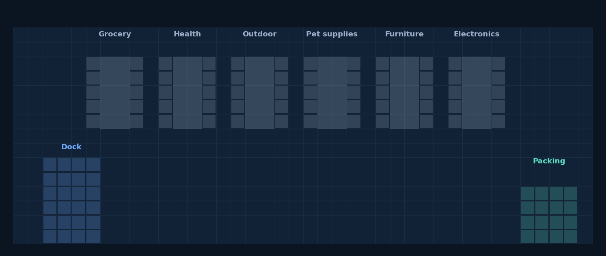
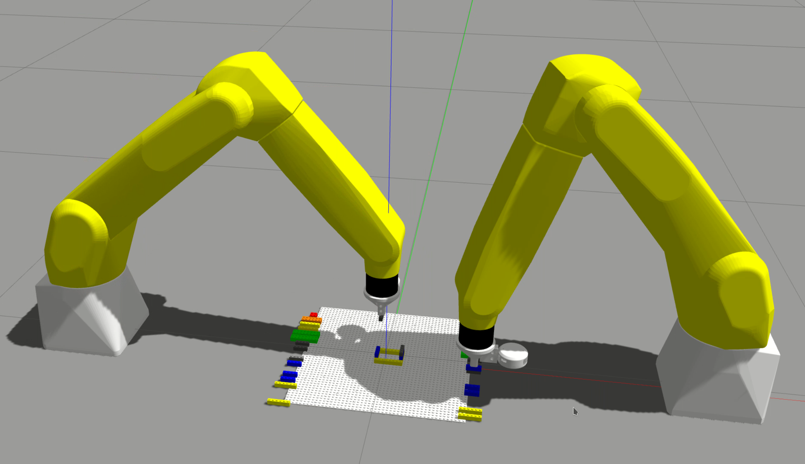
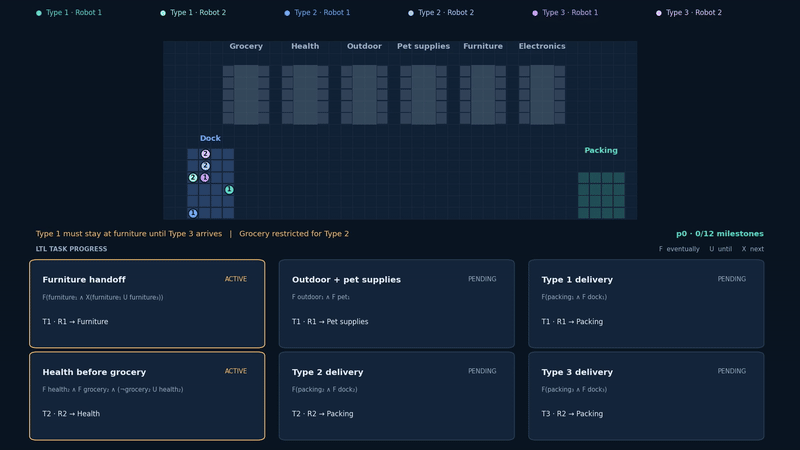
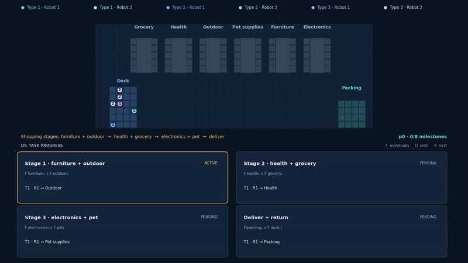
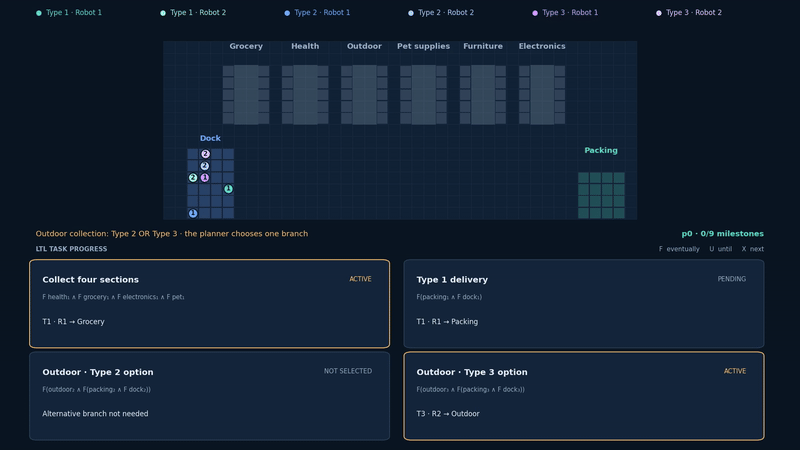
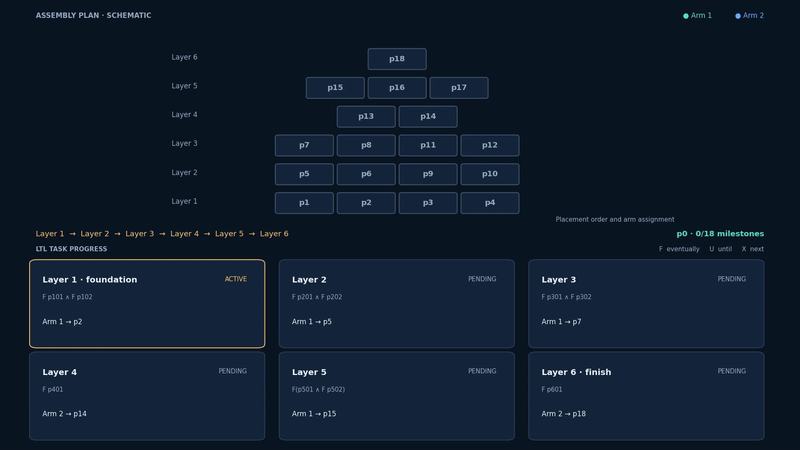
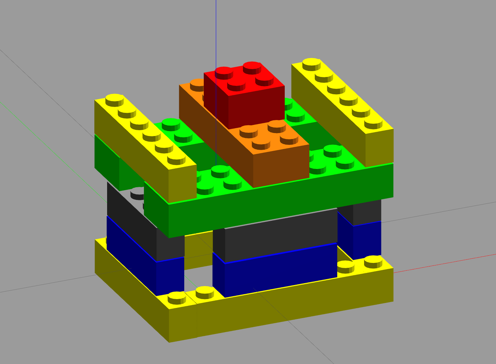

# Decomposition-based Hierarchical Task Allocation and Planning for Multi-Robots under Hierarchical Temporal Logic Specifications

**Xusheng Luo, Shaojun Xu, Ruixuan Liu, and Changliu Liu**

IEEE Robotics and Automation Letters, 2024

**[Project webpage and videos](https://xushengluo92.github.io/Hierarchical-LTL/)** · [Paper](https://arxiv.org/abs/2308.10393) · [Original demonstration](https://youtu.be/YbmYmq1RmhI)

## Overview

Past research into robotic planning with temporal logic specifications, notably Linear Temporal Logic (LTL), was largely based on singular formulas for individual or groups of robots. But with increasing task complexity, LTL formulas unavoidably grow lengthy, complicating interpretation and specification generation, and straining the computational capacities of the planners. In order to maximize the potential of LTL specifications, we capitalized on the intrinsic structure of tasks and introduced a hierarchical structure to LTL specifications. In contrast to the "flat" structure, our hierarchical model has multiple levels of compositional specifications and offers benefits such as greater syntactic brevity, improved interpretability, and more efficient planning. To address tasks under this hierarchical temporal logic structure, we formulated a decomposition-based method. Each specification is first broken down into a range of temporally interrelated  sub-tasks. We further mine the temporal relations among the sub-tasks of different specifications within the hierarchy. Subsequently, a Mixed Integer Linear Program is utilized to generate a spatio-temporal plan for each robot. Our hierarchical LTL specifications were experimentally applied to domains of robotic navigation and manipulation. Results from extensive simulation studies illustrated both the enhanced expressive potential of the hierarchical form and the efficacy of the proposed method.

## Install

The planner uses Python 3.10.12. Create its separate Conda environment:

```bash
conda env create -f environment.yml
conda activate hierarchical_ltl
pip install -e .
```

Compile [LTL2BA](http://www.lsv.fr/~gastin/ltl2ba/index.php), and place the executable `ltl2ba` alongside `main.py`. Install a valid full [Gurobi license](https://www.gurobi.com); the navigation models exceed the size-limited license. If necessary, point `GRB_LICENSE_FILE` to your local license file. Do not commit license files.

Graphviz and the LaTeX/dot2tex tools are needed for the original graph-export options. The presentation renderer uses the FFmpeg executable supplied by `imageio-ffmpeg`.

## Usage

Run the original planner and save a replay:

```bash
python main.py --task=nav --case=5 --seed=42 --export-replay=data/presentation/scenario_01.json
```

Run and render all four README examples:

```bash
python scripts/run_demo_batch.py
python scripts/render_demo_batch.py
python -m unittest discover -s tests -v
```

The scripts save solver logs and paths under `data/presentation`, and publishable videos, GIF previews, posters, replay JSON, and validation reports under `demo/generated`.

| Presentation | Planner arguments | Output |
| --- | --- | --- |
| Scenario 1 | `--task=nav --case=5` | `scenario_01` |
| Scenario 2 | `--task=nav --case=6` | `scenario_02` |
| Scenario 3 | `--task=nav --case=8` | `scenario_03` |
| Scenario 4 | `--task=man --case=6 --plan-only` | `scenario_05` |

All examples use seed 42 and `PYTHONHASHSEED=0`. This repository retains its original weighted MILP objective (0.7 routing cost + 0.3 summed subtask completion times); it does not implement the STAP repository’s `--cost=minmax` option. Navigation retains the original GMAPP collision-avoidance planner. No additional parking or scheduling layer is applied.

`--plan-only` skips interactive manipulation execution. Without it, the original manipulation task dispatcher waits for completion input.

## Simulation environment

### Navigation workspace



A 40 × 15 warehouse with grocery, health, outdoor, pet, furniture, and electronics departments, plus a dock and packing area. The team has two robots of each of three types.

### Manipulation workspace



Two arms share LEGO placement tasks. Their original simulation recording is retained on the [project page](https://xushengluo92.github.io/Hierarchical-LTL/#simulation).

## Planner-generated presentation demos

Click the preview below each scenario heading to play its MP4. The project page provides an embedded player for all four scenarios.

The LTL cards track the assigned robots, active tasks, milestones, and completion. In Scenario 1, Type 1 must stay at furniture until Type 3 arrives; the display releases that restriction at step 27. Type 2’s grocery restriction releases after visiting health. Scenario 3 labels the unused OR branch explicitly.

The independent monitor checks finite-trace leaf formulas with the planner’s robot identities and task activation windows, checks parent completion and precedence, and checks grid motion and collisions. All four displayed runs pass. Navigation mission horizons are 95, 116, and 85 steps; the house assembly schedule horizon is 20. The videos use 1080p at 30 fps, with two navigation steps per second (0.7 schedule steps per second for assembly) and a final two-second hold.

## Navigation tasks

### Scenario 1 — furniture assistance and delivery

[](https://xushengluo92.github.io/Hierarchical-LTL/demo/generated/scenario_01.mp4)

A Type 1 robot visits furniture and stays there until Type 3 arrives to help load a large item. Type 1 then collects outdoor and pet items in either order. Type 2 collects health items before groceries and must avoid grocery until health. Each participating robot delivers its items to packing and returns to the dock. See the [paper’s MRPD example](https://arxiv.org/html/2308.10393v3#S2.SS2).

### Scenario 2 — three ordered shopping stages

[](https://xushengluo92.github.io/Hierarchical-LTL/demo/generated/scenario_02.mp4)

One Type 1 robot collects furniture and outdoor items, then health and grocery items, then electronics and pet items. The two visits within each stage can occur in either order. Finally, it delivers to packing and returns to the dock. See [navigation Task 2](https://arxiv.org/html/2308.10393v3#S4.SS1).

### Scenario 3 — flexible outdoor collection

[](https://xushengluo92.github.io/Hierarchical-LTL/demo/generated/scenario_03.mp4)

Type 1 visits health, grocery, electronics, and pet supplies in any order. Either Type 2 or Type 3 handles outdoor collection; the planner chooses one of these branches. The assigned robots deliver to packing and return to the dock. See [navigation Task 3](https://arxiv.org/html/2308.10393v3#S4.SS1).

## Manipulation tasks

### Scenario 4 — house

[](https://xushengluo92.github.io/Hierarchical-LTL/demo/generated/scenario_05.mp4)



Build the house in six successive layers, respecting each layer’s placement dependencies and same-arm constraints. In layer 5, p15 and p16 must precede p17. See [the published house-model example](https://arxiv.org/html/2308.10393v3#S4.SS2.SSS2). The schematic shows logical layers and assignment, rather than brick geometry or arm trajectories.

## Citation

```bibtex
@article{luo2024decomposition,
  title={Decomposition-based Hierarchical Task Allocation and Planning for Multi-Robots under Hierarchical Temporal Logic Specifications},
  author={Luo, Xusheng and Xu, Shaojun and Liu, Ruixuan and Liu, Changliu},
  journal={IEEE Robotics and Automation Letters},
  year={2024}
}
```
